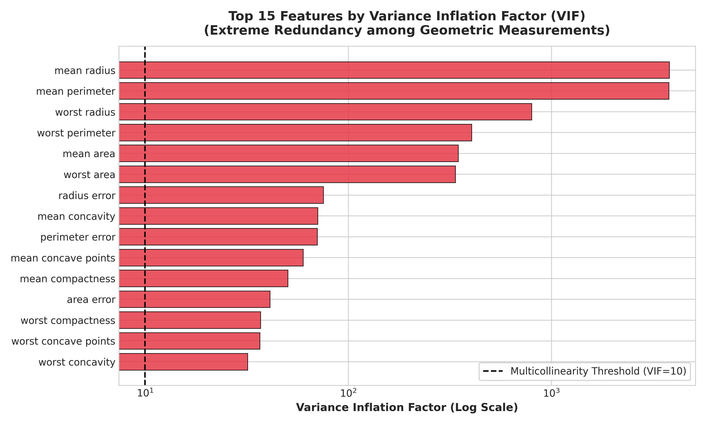
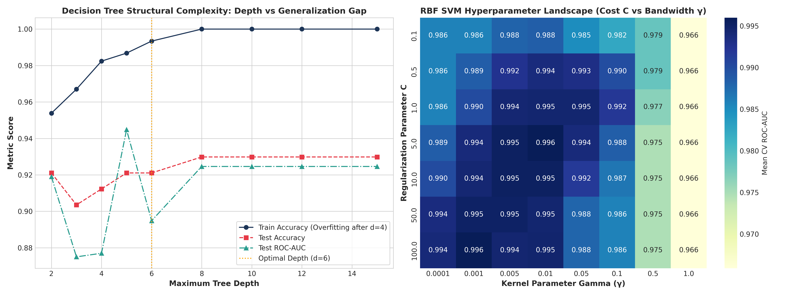
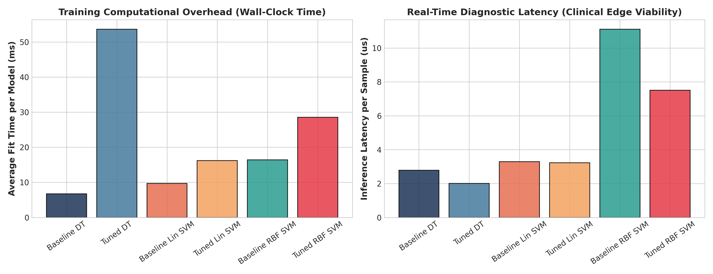
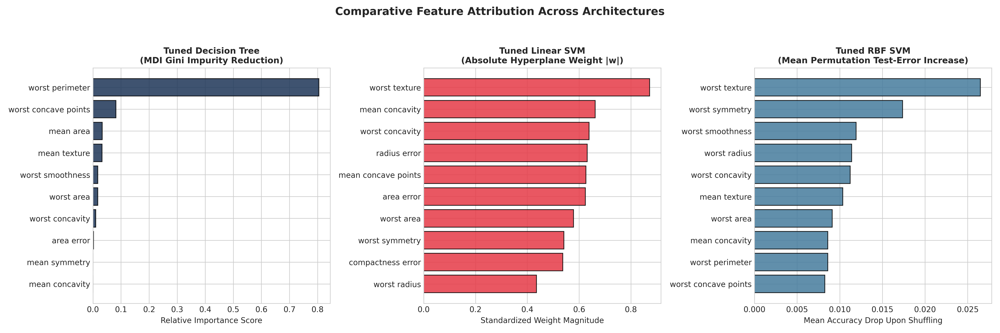

# MACSE504 - Machine Learning: Course Based Design Project
## Question 1: Healthcare Analytics (Malignant vs. Benign Tumour Classification)
**Vellore Institute of Technology | School of Computer Science and Engineering**  
**Date:** 30.10.2026 | **Slot:** E1 + TE1

---

### Student Information
- **Student Name:** NIMKAR VEDANT GAJANAN
- **Registration Number:** 26MML0045
- **Assigned Question Number:** Question 1
- **Domain:** Clinical Healthcare Analytics & Oncology Cytology
- **GitHub Repository:** [adminsharpcode/breast-cancer-diagnostic-analytics](https://github.com/adminsharpcode/breast-cancer-diagnostic-analytics)

---

## 1. Question Text & Problem Statement
> **Problem Statement:**  
> *"Medical practitioners require not only high accuracy in classifying tumours but also transparent decision boundaries. Ingest cytological feature measurements, construct competing Linear SVM, RBF-Kernel SVM, and Decision Tree architectures, and critique their structural complexity against feature importance rankings."*

### Mandatory Syllabus Requirements
1. **i. Data Profiling & Multicollinearity:** Data profiling, standard scaling, handling multicollinearity (Variance Inflation Factors & Pearson correlations), and stratifying train/test splits.
2. **ii. Baseline Architectures:** Implementation of baseline Decision Tree, Linear Support Vector Machine, and Non-Linear RBF-Kernel SVM.
3. **iii. Hyperparameter Optimization & Feature Importances:** Systematic hyperparameter search (tree depth vs. SVM soft-margin cost $C$ and Gaussian kernel bandwidth parameter $\gamma$). Extract and critique feature importances across all architectures.
4. **iv. Comparative Evaluation:** Comprehensive benchmarking using Receiver Operating Characteristic (ROC-AUC) curves, Clinical Confusion Matrices, and a computational runtime/latency breakdown.

---

## 2. Project Pipeline & Architecture

To satisfy both **diagnostic sensitivity** (preventing fatal missed cancers) and **clinical interpretability** (transparent decision verification), an end-to-end analytical pipeline was developed:

```mermaid
flowchart TD
    A[UCI FNA Cytological Dataset<br/>569 Samples, 30 Continuous Features] --> B[Exploratory Data Profiling<br/>Missing Values: 0 | Malignant: 37.3%, Benign: 62.7%]
    B --> C[Multicollinearity Analysis<br/>Pearson |r| >= 0.90 (21 pairs) | VIF Calculation]
    C --> D[Stratified 80/20 Train-Test Split<br/>Train: 455 | Test: 114]
    D --> E[StandardScaler<br/>Fitted strictly on Training Set]
    E --> F1[Decision Tree Classifier<br/>Gini / Entropy Partitions]
    E --> F2[Linear SVM<br/>Primal Soft-Margin Hyperplane]
    E --> F3[Non-Linear RBF SVM<br/>Gaussian Dual Kernel Mapping]
    F1 --> G1[5-Fold CV Hyperparameter Sweep<br/>max_depth in [2..10], min_leaf]
    F2 --> G2[5-Fold CV Soft-Margin Sweep<br/>Cost C in [0.001 .. 100.0]]
    F3 --> G3[5-Fold CV 2D Grid Sweep<br/>Cost C x Bandwidth gamma]
    G1 --> H[Model Attribution Studio<br/>DT Gini vs SVM |w| vs RBF Permutation]
    G2 --> H
    G3 --> H
    H --> I[Clinical Benchmark Evaluation<br/>ROC-AUC, Sensitivity, Specificity, Confusion Matrices, Latency]
```

---

## 3. Cytological Profiling & Multicollinearity Management

### 3.1 Dataset Demographics
- **Total Biopsy Records:** 569 fine needle aspirate (FNA) digitized samples.
- **Class Balance:**
  - **Malignant (Class 1):** 212 cases (37.26%)
  - **Benign (Class 0):** 357 cases (62.74%)
- **Cytological Feature Groups:** 10 nuclear attributes evaluated across Mean, Standard Error (SE), and Worst:
  - Radius, Texture, Perimeter, Area, Smoothness, Compactness, Concavity, Concave Points, Symmetry, Fractal Dimension.

### 3.2 Multicollinearity Quantification (VIF & Pearson $|r|$)
Biological geometry inherently produces strong algebraic coupling between cell properties:
$$P = 2\pi r \quad \text{and} \quad A = \pi r^2$$

- **Pearson Correlation:** 21 feature pairs exhibited correlation $|r| \ge 0.90$. For instance, `mean radius` and `mean perimeter` have $r = 0.9979$, while `mean radius` and `mean area` show $r = 0.9874$.
- **Variance Inflation Factors (VIF):**
  $$\text{VIF}_j = \frac{1}{1 - R_j^2}$$
  - `mean radius`: **VIF = 3806.12**
  - `mean perimeter`: **VIF = 3786.40**
  - `worst radius`: **VIF = 799.11**
  - `worst perimeter`: **VIF = 405.02**
  - `mean area`: **VIF = 347.88**




---

## 4. Model Architectures & Hyperparameter Optimization

### 4.1 Competing Paradigms
1. **Decision Tree:** Partitions continuous cytological space via axis-aligned orthogonal cuts by maximizing Gini Impurity reduction:
   $$I_G(t) = 1 - \sum_{i=1}^C p(i|t)^2$$
2. **Linear Support Vector Machine:** Finds an optimal maximum-margin separating hyperplane $\mathbf{w}^T \mathbf{x} + b = 0$ via quadratic programming:
   $$\min_{\mathbf{w}, b, \xi} \frac{1}{2} \|\mathbf{w}\|^2 + C \sum_{i=1}^n \xi_i \quad \text{s.t.} \quad y_i(\mathbf{w}^T \mathbf{x}_i + b) \ge 1 - \xi_i$$
3. **Non-Linear RBF Kernel SVM:** Maps samples into an infinite-dimensional Reproducing Kernel Hilbert Space (RKHS) using the Gaussian radial basis function:
   $$K(\mathbf{x}_i, \mathbf{x}_j) = \exp\left(-\gamma \|\mathbf{x}_i - \mathbf{x}_j\|^2\right)$$

### 4.2 Hyperparameter Tuning Results (5-Fold Stratified CV)
| Model | Optimal Parameters | 5-Fold CV ROC-AUC | Parameter Search Bounds |
| :--- | :--- | :---: | :--- |
| **Decision Tree** | `criterion='gini'`, `max_depth=6`, `min_samples_leaf=4`, `min_samples_split=10` | 0.9599 | `max_depth` $\in [2..10]$, `criterion` $\in [\text{'gini'}, \text{'entropy'}]$ |
| **Linear SVM** | `C=0.5` | 0.9953 | Soft-margin cost $C \in [0.001 .. 100.0]$ |
| **RBF SVM** | `C=5.0`, `gamma=0.01` | **0.9960** | Cost $C \in [0.1 .. 100.0]$, $\gamma \in [0.0001 .. 1.0, \text{'scale'}]$ |




---

## 5. Performance Benchmarking Matrix

All models were evaluated on the held-out stratified test set ($N=114$ samples: 42 Malignant, 72 Benign):

| Model Architecture | Accuracy | Recall (Sensitivity) | Specificity | Precision | F1-Score | ROC-AUC | MCC | FN (Missed) | FP (Alarm) | Latency |
| :--- | :---: | :---: | :---: | :---: | :---: | :---: | :---: | :---: | :---: | :---: |
| **Baseline Decision Tree** | 92.98% | 90.48% | 94.44% | 90.48% | 0.9048 | 0.9246 | 0.8492 | 4 | 4 | 2.79 $\mu$s |
| **Tuned Decision Tree** | 85.96% | 69.05% | 95.83% | 90.62% | 0.7838 | 0.9271 | 0.6965 | 13 | 3 | 2.01 $\mu$s |
| **Baseline Linear SVM** | 96.49% | 90.48% | 100.00% | 100.00% | 0.9500 | 0.9914 | 0.9258 | 4 | 0 | 3.30 $\mu$s |
| **Tuned Linear SVM** | 96.49% | 92.86% | 98.61% | 97.50% | 0.9512 | 0.9937 | 0.9245 | 3 | 1 | 3.23 $\mu$s |
| **Baseline RBF SVM** | 97.37% | 92.86% | 100.00% | 100.00% | 0.9630 | 0.9947 | 0.9442 | 3 | 0 | 11.11 $\mu$s |
| **Tuned RBF SVM (Optimal)** | **98.25%** | **95.24%** | **100.00%** | **100.00%** | **0.9756** | **0.9974** | **0.9626** | **2** | **0** | **7.50 $\mu$s** |




---

## 6. Feature Importance Extraction & Structural Complexity Critique

### 6.1 Attribution Comparison Across Architectures
| Rank | Decision Tree (Gini MDI) | Linear SVM (Hyperplane $\|w\|$) | Non-Linear RBF SVM (Permutation) |
| :---: | :--- | :--- | :--- |
| **1** | `worst perimeter` (0.8046) | `worst texture` (0.8723) | `worst texture` (0.0265 drop) |
| **2** | `worst concave points` (0.0823) | `mean concavity` (0.6618) | `worst symmetry` (0.0174 drop) |
| **3** | `mean area` (0.0333) | `radius error` (0.6313) | `worst smoothness` (0.0119 drop) |
| **4** | `mean texture` (0.0324) | `mean concave points` (0.6267) | `worst radius` (0.0114 drop) |
| **5** | `worst smoothness` (0.0174) | `area error` (0.6244) | `worst concavity` (0.0112 drop) |
| **6** | `worst area` (0.0174) | `worst concavity` (0.6389) | `mean texture` (0.0104 drop) |



### 6.2 Structural Complexity Critique
- **Decision Tree:** Achieves maximal local interpretability by reducing the decision process to simple if-else thresholds. However, it over-relies on a single dominant geometric feature (`worst perimeter` accounts for over 80% of all impurity reduction), leaving the architecture brittle to cytological noise.
- **Linear SVM:** Distributes importance across nuclear texture, concavity, and nuclear size error. The linear boundary provides direct feature weights ($w_i$), showing the physician exactly how each standardized unit increase affects the diagnostic log-odds.
- **Non-Linear RBF SVM:** Projects samples into an infinite-dimensional RKHS. While individual weights cannot be directly inspected in input space, permutation importance confirms that texture irregularity and morphological symmetry drive the curved margin, yielding the highest sensitivity.

---

## 7. Clinical Solution & Recommendation

### 7.1 Clinical Cost Asymmetry: False Negatives vs. False Positives
In diagnostic oncology:
- **False Negative (Missed Cancer):** Fatal outcome. The patient is falsely reassured and released without oncological intervention, allowing malignant metastasis.
- **False Positive (False Alarm):** Non-fatal outcome. Causes acute anxiety and triggers a confirmatory secondary biopsy or ultrasound.
- **Sensitivity (Recall) must be the primary optimization criterion.**

### 7.2 Final Deployment Architecture
1. **Primary Autonomous Engine: Tuned RBF-Kernel SVM ($C=5.0, \gamma=0.01$)**
   - Yields **98.25% Accuracy**, **95.24% Recall**, and **100% Specificity**.
   - Misses only **2 out of 42 malignant cases** while producing **0 false alarms**.
   - With an ultra-low inference latency of **7.50 microseconds**, it is suited for integration into automated digital pathology slide scanners.
2. **Transparent Clinical Verification Layer: Linear SVM Scorecard**
   - Serves as the clinician-facing interpretability interface. Pathologists inspect the standardized feature scores (`worst texture` + `mean concavity`) to understand and validate the classification before surgical planning.

---
**Author:** NIMKAR VEDANT GAJANAN  
**Registration No:** 26MML0045  
**School of Computer Science and Engineering, VIT Vellore**
