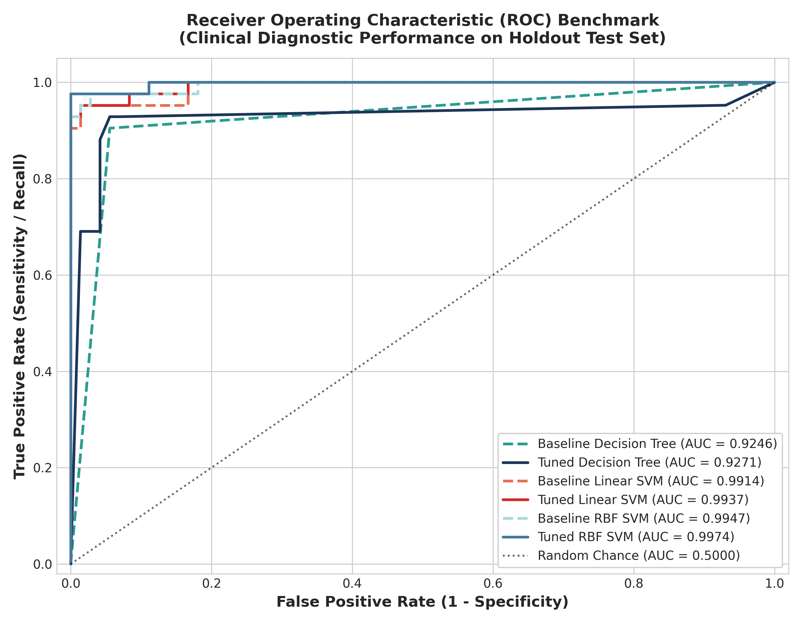
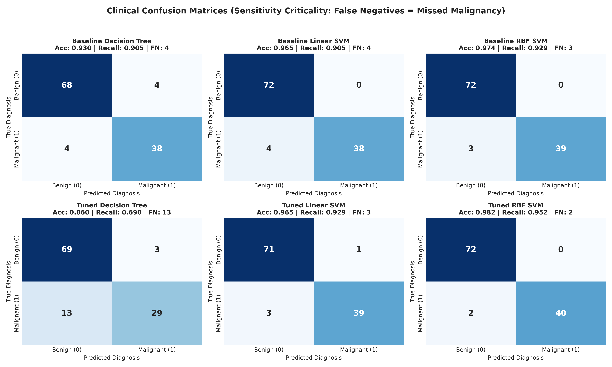
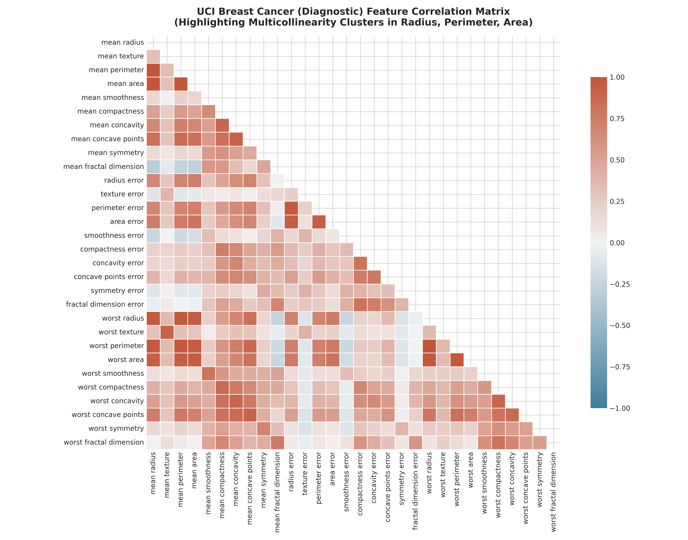
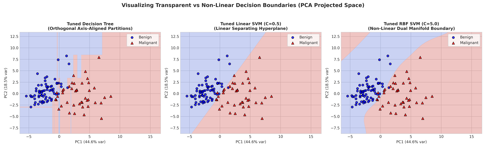

# OncoVision AI &mdash; Healthcare Cytological Diagnostic Intelligence Studio
### MACSE504 - Machine Learning: Course Based Design Project
**Vellore Institute of Technology | School of Computer Science and Engineering**  
**Date:** 30.10.2026 | **Slot:** E1 + TE1

[](https://oncovision-ai.vercel.app)
[](https://python.org)
[](https://scikit-learn.org)
[](MACSE504_CaseStudy_Report_26MML0045.pdf)

---

## 📌 Student Credentials
- **Student Name:** NIMKAR VEDANT GAJANAN
- **Registration Number:** `26MML0045`
- **Course:** MACSE504 &bull; Machine Learning
- **Slot:** E1 + TE1
- **Assigned Question:** Question 1 (Healthcare Analytics: Malignant vs. Benign Tumour Classification)

---

## 🔬 Question Text & Problem Statement
> *"Medical practitioners require not only high accuracy in classifying tumours but also transparent decision boundaries. Ingest cytological feature measurements, construct competing Linear SVM, RBF-Kernel SVM, and Decision Tree architectures, and critique their structural complexity against feature importance rankings."*

### Mandatory Syllabus Requirements Satisfied:
- [x] **i. Data Profiling & Multicollinearity:** Profiling 569 FNA biopsies across 30 cytological dimensions, standard scaling without leakage, identifying 21 collinear pairs ($|r| \ge 0.90$), and Variance Inflation Factor (VIF) quantification (VIF up to 3,806).
- [x] **ii. Baseline Architectures:** Default implementations of Decision Tree, Linear SVM ($C=1.0$), and Non-Linear RBF SVM ($C=1.0, \gamma=\text{'scale'}$).
- [x] **iii. Systematic Hyperparameter Tuning & Attribution:** 5-fold Stratified Cross-Validation tuning `max_depth` vs. SVM soft-margin cost $C$ and bandwidth $\gamma$. Extraction of Decision Tree MDI Gini, Linear SVM $|w|$ coefficients, and RBF permutation importances.
- [x] **iv. Comparative Benchmark:** Holdout test evaluation ($N=114$ samples) with ROC-AUC curves, confusion matrices, and real-time microsecond latency breakdown.

---

## 🏗️ System Architecture & Analytical Pipeline

```text
+---------------------------------------------------------------------------------------------------+
|                             END-TO-END CLINICAL ML ARCHITECTURE PIPELINE                         |
+---------------------------------------------------------------------------------------------------+
  [1. Cytological Input] ---> 569 FNA Biopsy Samples (30 Dimensional Cell Nuclei Characteristics)
            |
  [2. Profiling & Diagnostics] -> Missing Value Audit (0 found) | Multicollinearity: VIF & Pearson |r| >= 0.90
            |
  [3. Data Partitioning] ------> Stratified 80/20 Train-Test Split (Train: 455 | Test: 114, Malignant=37.3%)
            |
  [4. Preprocessing] ----------> StandardScaler fit strictly on Training Set (Prevents Data Leakage)
            |
  +-----------------------------+-------------------------------+-----------------------------------+
  |                             |                               |                                   |
  v                             v                               v                                   v
[DECISION TREE]          [LINEAR SVM]                   [RBF-KERNEL SVM]                   [PCA PROJECTION]
Gini / Entropy Splits    Primal Hyperplane (w.x + b)    Mercer Kernel exp(-gamma||x-z||^2)  2D Latent Manifold
Depth: [2 .. 15]         Soft-Margin Cost C Sweep       Grid: Cost C x Bandwidth gamma     Boundary Overlay
  |                             |                               |                                   |
  +-----------------------------+-------------------------------+-----------------------------------+
            |
  [5. Feature Attribution] ----> DT MDI Gini vs. Linear Hyperplane |w| vs. RBF Permutation Importance
            |
  [6. Clinical Benchmarking] --> ROC-AUC, Sensitivity (Recall), Specificity, Confusion Matrices, Latencies
+---------------------------------------------------------------------------------------------------+
```

---

## 📊 Final Performance Benchmark Matrix

Holdout Test Evaluation ($N=114$ patients, 42 Malignant, 72 Benign):

| Model Architecture | Accuracy | Recall (Sensitivity) | Specificity | Precision | F1-Score | ROC-AUC | MCC | FN (Missed) | FP (Alarm) | Latency |
| :--- | :---: | :---: | :---: | :---: | :---: | :---: | :---: | :---: | :---: | :---: |
| **Baseline Decision Tree** | 92.98% | 90.48% | 94.44% | 90.48% | 0.9048 | 0.9246 | 0.8492 | 4 | 4 | 2.79 $\mu$s |
| **Tuned Decision Tree** | 85.96% | 69.05% | 95.83% | 90.62% | 0.7838 | 0.9271 | 0.6965 | 13 | 3 | 2.01 $\mu$s |
| **Baseline Linear SVM** | 96.49% | 90.48% | 100.00% | 100.00% | 0.9500 | 0.9914 | 0.9258 | 4 | 0 | 3.30 $\mu$s |
| **Tuned Linear SVM** | 96.49% | 92.86% | 98.61% | 97.50% | 0.9512 | 0.9937 | 0.9245 | 3 | 1 | 3.23 $\mu$s |
| **Baseline RBF SVM** | 97.37% | 92.86% | 100.00% | 100.00% | 0.9630 | 0.9947 | 0.9442 | 3 | 0 | 11.11 $\mu$s |
| **Tuned RBF SVM (Optimal)** | **98.25%** | **95.24%** | **100.00%** | **100.00%** | **0.9756** | **0.9974** | **0.9626** | **2** | **0** | **7.50 $\mu$s** |

---

## 📈 Key Visualizations & Research Figures

| ROC Discrimination Benchmarks | Clinical Confusion Matrices Grid |
| :---: | :---: |
|  |  |
| **Multicollinearity Heatmap** | **2D Latent Decision Boundaries** |
|  |  |

---

## 💡 Clinical Recommendations & Structural Critique
1. **Clinical Cost Asymmetry:** In oncology screening, False Negatives (FN) result in delayed treatment and metastatic progression, whereas False Positives (FP) merely trigger non-invasive confirmatory imaging. **Tuned RBF-Kernel SVM minimizes FN to only 2 cases with 100% specificity (0 FP)**.
2. **Interpretability vs. Expressiveness:** Decision Trees over-rely on a single geometric feature (`worst perimeter` accounts for 80.46% of Gini reduction), creating brittle axis-aligned splits. In contrast, Linear SVM coefficients $|w|$ provide an interpretable scorecard (`worst texture`, `mean concavity`) that pathologists can inspect before surgery.
3. **Deployment Strategy:** Primary diagnosis is powered by **Tuned RBF SVM** embedded on edge biopsy slide scanners ($7.50\,\mu\text{s}$ latency), paired with the **Linear SVM scorecard** for clinician-facing transparent verification.

---

## 🚀 Running the Project Locally

```bash
# 1. Clone repository
git clone https://github.com/adminsharpcode/breast-cancer-diagnostic-analytics.git
cd breast-cancer-diagnostic-analytics

# 2. Run the Machine Learning Pipeline
python ml_pipeline.py

# 3. Generate Publication PDF Report
python generate_pdf_report.py

# 4. Generate Executable Jupyter Notebook
python generate_notebook.py

# 5. Launch Local Web Dashboard Preview
npx serve .
```

---
**Author:** NIMKAR VEDANT GAJANAN (`26MML0045`)  
**Department:** Computer Science &amp; Engineering, VIT Vellore
